# Sortir mes VM de VMware Workstation vers Proxmox, sans perdre mon domaine

Mon PC Windows 11 n'avait plus de place. Pas "un peu juste", plus du tout.

Au fil de mes cours, j'ai monté VM sur VM, chacune avec ses snapshots empilés, et le disque a fini par ressembler à un cimetière de fichiers `.vmdk`. Faire le ménage aurait été facile, sauf qu'au milieu du tas il y avait mon contrôleur de domaine : un Active Directory monté à la main, avec ses utilisateurs, son DNS, sa config. Tout recommencer de zéro, c'était hors de question.

Heureusement, il y a un serveur Proxmox chez moi qui ne fait pas grand-chose. L'idée était simple : lui envoyer les VM, vérifier qu'elles tournent, et seulement ensuite libérer de la place sur le PC.

Le hic, c'est que je n'étais pas chez moi. Tout devait passer par Tailscale, et mon premier `scp` a fini en timeout. Ce repo raconte ce qui a fini par marcher, dans l'ordre, avec les erreurs que j'ai croisées en route (dont une boîte de dialogue VMware Tools qui s'est invitée au premier démarrage).

> Les adresses IP et MAC sont volontairement remplacées par des valeurs génériques (`100.x.y.z`, etc.). Mettez les vôtres.

## Sommaire

- [Ce que j'avais, ce que je visais](#ce-que-javais-ce-que-je-visais)
- [Le plan en un coup d'œil](#le-plan-en-un-coup-dœil)
- [1. Préparer les VM dans Workstation](#1-préparer-les-vm-dans-workstation)
- [2. Compter la place côté Proxmox](#2-compter-la-place-côté-proxmox)
- [3. Envoyer les fichiers](#3-envoyer-les-fichiers)
- [4. Vérifier que rien n'a bougé](#4-vérifier-que-rien-na-bougé)
- [5. Créer les VM et importer les disques](#5-créer-les-vm-et-importer-les-disques)
- [6. Attacher le disque et passer en UEFI](#6-attacher-le-disque-et-passer-en-uefi)
- [7. Premier démarrage](#7-premier-démarrage)
- [8. L'erreur VMware Tools](#8-lerreur-vmware-tools)
- [9. Mes données sont-elles toujours là ?](#9-mes-données-sont-elles-toujours-là-)
- [10. Ranger derrière soi](#10-ranger-derrière-soi)
- [Les accrocs, en vrac](#les-accrocs-en-vrac)
- [Checklist](#checklist)

## Ce que j'avais, ce que je visais

| | Source | Cible |
|---|---|---|
| Hyperviseur | VMware Workstation (PC Windows 11) | Proxmox VE 9.1 (QEMU 7.2) |
| Réseau | Tailscale, je suis à distance | Serveur à la maison |
| Stockage | Disque du PC saturé | 1 NVMe de 238 Go : `/` avec 55 Go libres, `local-lvm` avec 141 Go |
| Démarrage des VM | UEFI | UEFI (OVMF) |

Les deux VM migrées dans ce guide :

| VM | Système | RAM | CPU | Disque | ID Proxmox |
|---|---|---|---|---|---|
| WinServ | Windows Server 2019 (AD DS, DNS) | 2 Go | 2 | 30 Go | 200 |
| Client1 | Windows 10 | 1,4 Go, portée à 2 Go | 2 | 30 Go | 204 |

Chaque disque est découpé en huit morceaux (`-s001.vmdk` à `-s008.vmdk`). Au total, ça pèse autour de 36 Go pour les deux machines.

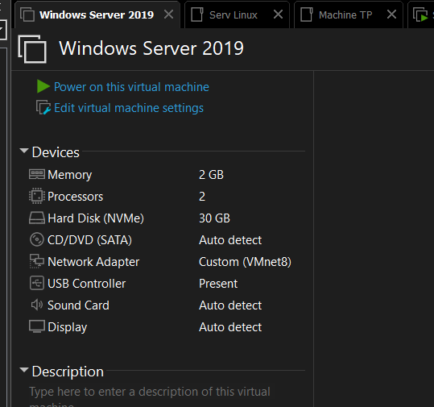
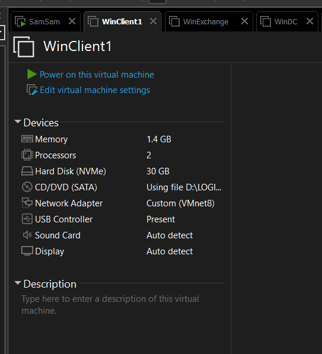

## Le plan en un coup d'œil

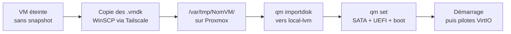

Le disque `.vmdk` est copié tel quel puis converti par Proxmox. Rien à l'intérieur n'est modifié, donc l'Active Directory, les fichiers et les comptes arrivent intacts. Ce qui peut mal tourner, c'est le démarrage (mode UEFI, pilotes), et c'est là que se trouvent presque tous les réglages ci-dessous.

## 1. Préparer les VM dans Workstation

Éteindre la VM depuis Windows, pas avec "Suspend". Ensuite, supprimer tous les snapshots dans *VM → Snapshot → Snapshot Manager*. Tant qu'il en reste, les données récentes sont éparpillées dans des fichiers `-000001.vmdk` et l'import ne les verra pas.

Quand le Snapshot Manager n'affiche plus que "You Are Here", c'est bon.

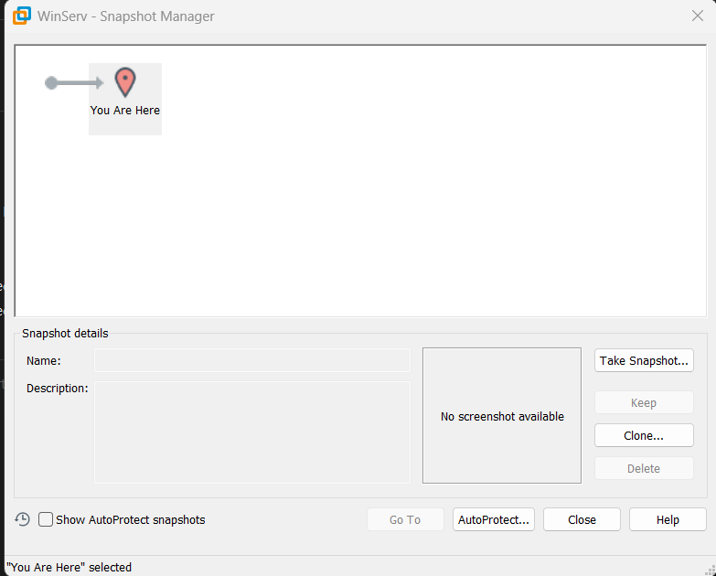
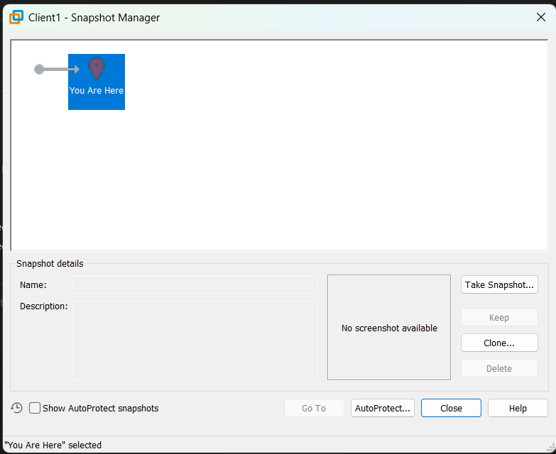

Ouvrez aussi le fichier `.vmx` avec le Bloc-notes. Il ne sert pas à l'import, mais il garde la config d'origine :

- `memsize` pour la RAM en Mo, `numvcpus` pour les processeurs
- `firmware = "efi"` si la VM démarre en UEFI (si la ligne n'existe pas, c'est du BIOS)
- `guestOS` pour le système invité

Chez moi, les deux machines étaient en UEFI. C'est le détail qui décide de tout au moment de recréer la VM.

Les fichiers à envoyer : le `.vmdk` descripteur (le petit, 1 Ko, sans `-s00X` dans son nom), tous les `-s00X.vmdk`, et le `.vmx` pour mémoire. Les `.vmem`, `.vmss`, `.log`, `.nvram` ne servent à rien ici et peuvent peser lourd.

## 2. Compter la place côté Proxmox

```bash
df -h
lsblk
pvesm status
```

Chez moi : 55 Go libres sur `/` (c'est là que je dépose les fichiers temporairement) et 141 Go sur `local-lvm` (là où les disques finissent).

Le piège, c'est que les données existent en double pendant l'import : une fois dans `/var/tmp`, une fois dans `local-lvm`. Les `.vmdk` copiés doivent donc tenir dans l'espace libre de `/`, et le disque virtuel dans celui de `local-lvm`. Avec 36 Go pour les deux VM, j'avais de la marge.

## 3. Envoyer les fichiers

### Ce qui n'a pas marché : scp

Mon premier réflexe a été `scp`, avec l'IP Tailscale du serveur :

```powershell
PS C:\Users\moi> scp -r "D:\VM\WinServ" root@100.x.y.z:/var/tmp/
ssh: connect to host 100.x.y.z port 22: Connection timed out
C:\WINDOWS\System32\OpenSSH\scp.exe: Connection closed
```

Le ping, lancé juste avant, donnait déjà un signal d'alerte :

```text
Statistiques Ping pour 100.x.y.z :
    Paquets : envoyés = 4, reçus = 4, perdus = 0 (perte 0%),
Durée approximative des boucles en millisecondes :
    Minimum = 45ms, Maximum = 1555ms, Moyenne = 428ms
```

(Sortie d'origine, seule l'adresse IP a été remplacée.)

428 ms de moyenne et un pic à plus d'une seconde et demie, c'est très loin d'un réseau local (1 à 2 ms) et même d'une bonne liaison Tailscale directe. Mon trafic passait très probablement par un relais DERP, ces serveurs publics que Tailscale utilise quand la connexion directe échoue. Pour de petits fichiers, ça passe. Pour des dizaines de Go, non.

Pour savoir où on en est :

```powershell
tailscale ping 100.x.y.z
```

Si la réponse contient `via DERP(...)`, c'est un relais. Si elle contient une IP et un port, la connexion est directe.

Au passage, si vous êtes sur le même réseau que le serveur, utilisez son IP locale (`192.168.x.x`) et oubliez tout ce qui suit sur WinSCP, ce sera bien plus rapide.

### Ce qui a marché : WinSCP

`scp` repart de zéro à chaque coupure. WinSCP, lui, sait reprendre là où il s'est arrêté, ce qui change tout sur un lien qui flanche.

Connexion en SFTP vers l'IP Tailscale, port 22, utilisateur `root`.

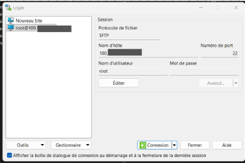

Dans *Avancé → Connexion*, j'ai réglé le timeout à 120 secondes et activé l'envoi de paquets SSH vides toutes les 15 secondes. Sans ça, la session tombait dès que le lien ralentissait. Pensez aussi à activer la reprise des transferts dans *Outils → Préférences → Transfert → Reprise*.

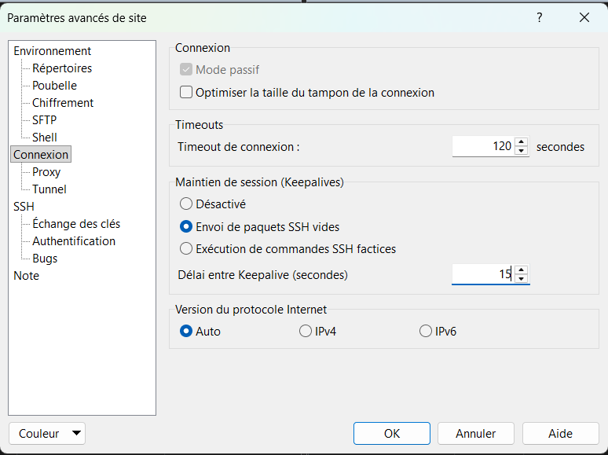

Côté serveur, un dossier par VM sous `/var/tmp/` (`WinServ`, `Client1`), et on y glisse les `.vmdk` et le `.vmx`. Les `-s00X` doivent rester dans le même dossier que le descripteur, sinon l'import échoue.

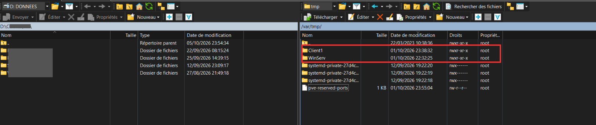

Une fois la copie terminée, voilà ce que j'avais :

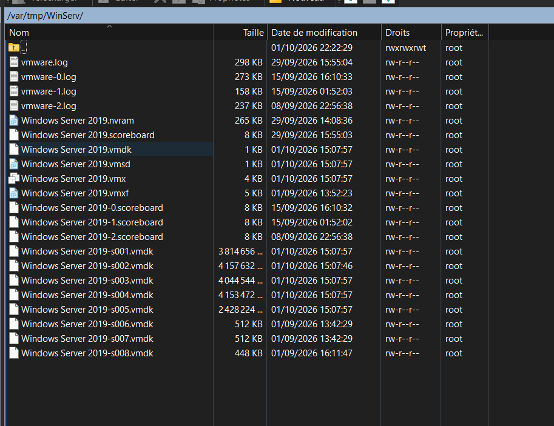
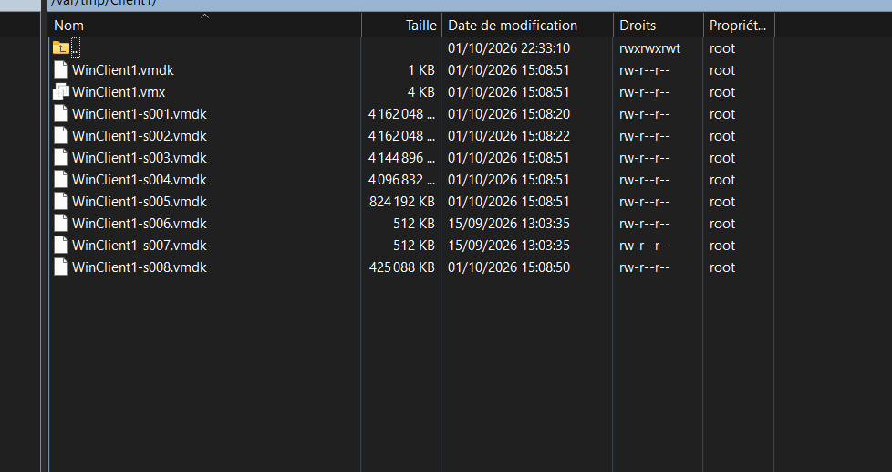

Les huit morceaux sont là pour chaque VM. Le temps de transfert dépend entièrement de votre lien, prévoyez de laisser le PC allumé et d'empêcher la mise en veille.

## 4. Vérifier que rien n'a bougé

Sur le serveur :

```bash
ls -lh /var/tmp/WinServ/ /var/tmp/Client1/
```

Les tailles doivent être identiques à celles du dossier d'origine, fichier par fichier. Si vous voulez être sûr à 100 %, comparez une empreinte :

```bash
sha256sum "/var/tmp/WinServ/Windows Server 2019-s001.vmdk"
```

```powershell
Get-FileHash "D:\VM\WinServ\Windows Server 2019-s001.vmdk"
```

Deux valeurs identiques, le fichier est parfait. C'est aussi le moment de confirmer l'UEFI :

```bash
grep -i firmware /var/tmp/WinServ/*.vmx /var/tmp/Client1/*.vmx
```

Une ligne `firmware = "efi"` par VM, et on sait qu'il faudra OVMF côté Proxmox.

## 5. Créer les VM et importer les disques

Les IDs de VM sont uniques dans tout le datacenter, vérifiez qu'ils sont libres. J'ai pris 200 pour le serveur et 204 pour le client.

```bash
qm create 200 --name WinServ2019 --ostype win10 --memory 2048 --cores 2 --cpu host \
  --net0 e1000,bridge=vmbr0 --scsihw virtio-scsi-single

qm importdisk 200 "/var/tmp/WinServ/Windows Server 2019.vmdk" local-lvm
```

```bash
qm create 204 --name Client1 --ostype win10 --memory 2048 --cores 2 --cpu host \
  --net0 e1000,bridge=vmbr0 --scsihw virtio-scsi-single

qm importdisk 204 "/var/tmp/Client1/WinClient1.vmdk" local-lvm
```

Quelques choix, pour ne pas les copier à l'aveugle. La carte réseau est une `e1000` parce que Windows la reconnaît sans pilote. Le disque passera en SATA à l'étape suivante pour la même raison. J'ai monté Client1 à 2 Go de RAM au lieu de 1,4 Go, Windows 10 respire mieux.

L'import peut durer un moment. Attendez les 100 % et le retour du prompt, puis vérifiez :

```bash
qm config 200 | grep unused
qm config 204 | grep unused
```

Vous devez voir `unused0: local-lvm:vm-200-disk-0` (et `vm-204-disk-0`). Le disque est importé mais pas encore branché.

## 6. Attacher le disque et passer en UEFI

```bash
qm set 200 --sata0 local-lvm:vm-200-disk-0 --bios ovmf \
  --efidisk0 local-lvm:1,efitype=4m,pre-enrolled-keys=0 --boot order=sata0

qm set 204 --sata0 local-lvm:vm-204-disk-0 --bios ovmf \
  --efidisk0 local-lvm:1,efitype=4m,pre-enrolled-keys=0 --boot order=sata0
```

`--bios ovmf` active l'UEFI, et `--efidisk0` crée le petit disque de 4 Mo qui garde ses variables. J'ai mis `pre-enrolled-keys=0` pour désactiver Secure Boot, que mes VM VMware n'utilisaient pas : le laisser actif aurait pu bloquer le démarrage.

Vérification avec `qm config 200` et `qm config 204`. Dans chacune, on doit retrouver `bios: ovmf`, un `efidisk0`, un `sata0` de 30G et `boot: order=sata0`.

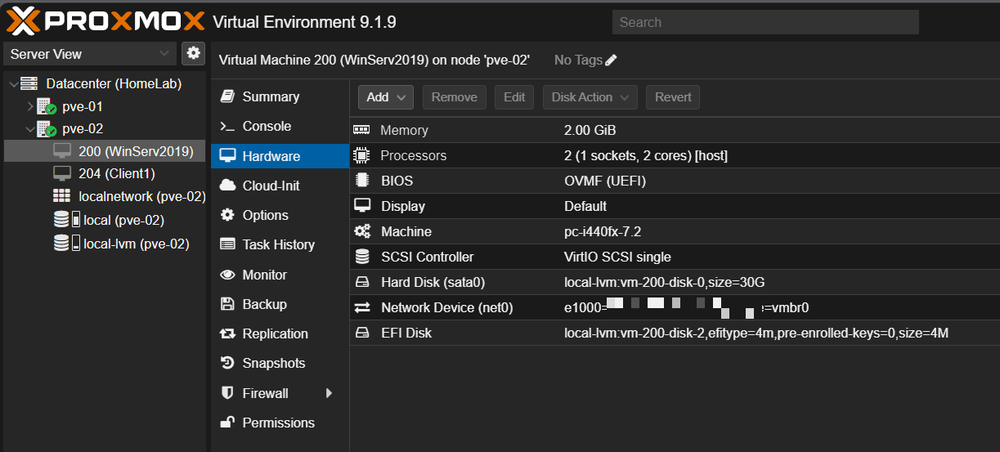
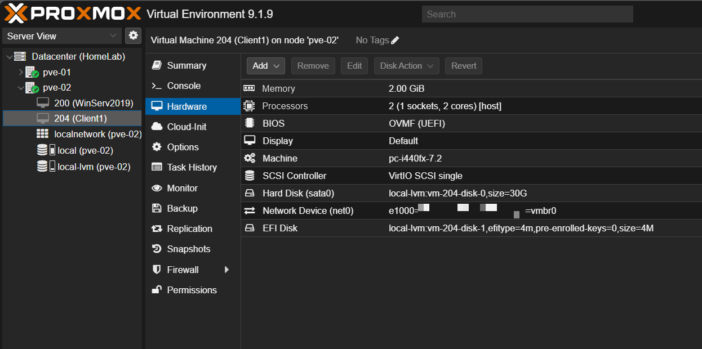

## 7. Premier démarrage

```bash
qm start 200
qm start 204
```

Console dans l'interface web, et les deux écrans de connexion apparaissent. Sur le serveur, c'est le compte du domaine qui est proposé. Sur le client, un compte `administrator@` du domaine : preuve que l'identité du domaine a bien suivi.

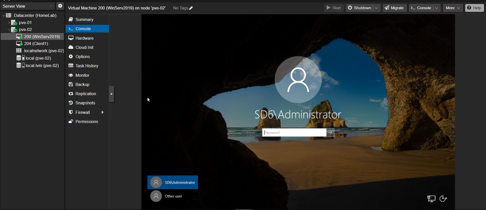
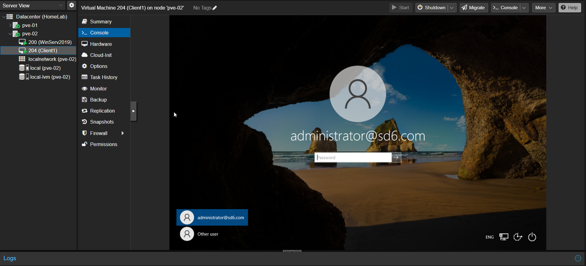

Si la VM s'arrête sur l'UEFI Shell ou affiche "No bootable device", c'est que l'entrée de démarrage de Windows vivait dans le NVRAM de VMware et pas sur le disque. On la recrée à la main :

1. Redémarrer et appuyer sur Échap au logo Proxmox.
2. *Boot Maintenance Manager → Boot From File*, choisir la partition.
3. Ouvrir `EFI → Microsoft → Boot → bootmgfw.efi`.
4. Une fois dans Windows, dans une invite de commandes en administrateur : `bcdboot C:\Windows`.

## 8. L'erreur VMware Tools

Dès l'ouverture de session sur le serveur, une fenêtre est apparue :

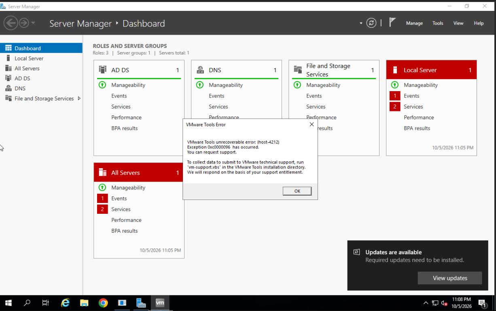

*VMware Tools unrecoverable error: (host-4212), Exception 0xc0000096 has occurred.*

Rien de grave, et ça se comprend vite. Les VMware Tools étaient toujours installés dans Windows, et au démarrage ils essaient de parler à un hyperviseur VMware qui n'existe plus. Sous Proxmox (QEMU/KVM), ils tombent dans le vide et plantent. Le code d'erreur `0xc0000096` correspond à une instruction privilégiée refusée, ce qui colle avec ce scénario.

La solution, c'est de désinstaller les VMware Tools :

1. Fermer la fenêtre d'erreur avec OK.
2. Ouvrir *Paramètres → Applications* (ou lancer `appwiz.cpl`), sélectionner **VMware Tools** et désinstaller.
3. Si la désinstallation refuse de se lancer, passer par PowerShell en administrateur :
   ```powershell
   Get-Package -Name "VMware Tools" | Uninstall-Package
   ```
4. Redémarrer la VM.

Dans la foulée, remplacer par les outils côté Proxmox. Monter l'ISO des [pilotes VirtIO](https://pve.proxmox.com/wiki/Windows_VirtIO_Drivers) sur le lecteur CD de la VM, lancer `virtio-win-guest-tools.exe` (pilotes et agent QEMU d'un coup), puis activer l'agent côté Proxmox :

```bash
qm set 200 --agent enabled=1
```

Il faut un arrêt complet suivi d'un démarrage pour que l'option soit prise en compte. Le même traitement vaut pour Client1.

## 9. Mes données sont-elles toujours là ?

La seule question qui comptait. Sur WinServ, le Gestionnaire de serveur affiche toujours ses rôles (AD DS, DNS, services de fichiers). Dans l'explorateur, mes dossiers de VMware sont là, et dans *Utilisateurs et ordinateurs Active Directory*, le compte que j'avais créé auparavant est toujours dans l'annuaire.

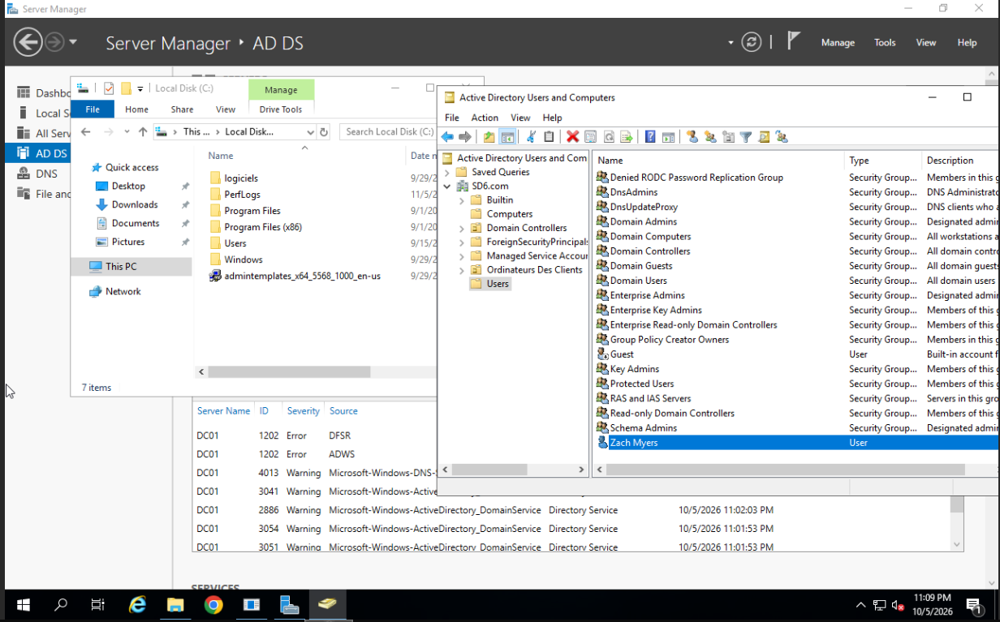

Dans le journal en bas de cette capture, on voit quelques avertissements DFSR et ADWS. Ils datent du démarrage, et ce genre de messages est courant juste après le redémarrage d'un contrôleur de domaine. Je ne les ai pas creusés, donc surveillez qu'ils ne reviennent pas à chaque démarrage (un `dcdiag` en cas de doute).

Autre chose à garder en tête : l'adresse MAC a changé, et mes machines étaient sur le réseau NAT de Workstation (VMnet8). Si votre domaine repose sur des IP fixes dans ce sous-réseau, il faudra reproduire cet adressage côté Proxmox, par exemple avec un bridge isolé.

## 10. Ranger derrière soi

Seulement quand tout est validé :

```bash
rm -r /var/tmp/WinServ /var/tmp/Client1
```

Et c'est seulement après que je pourrai supprimer les VM d'origine sur mon PC. Pas avant. Tant que la copie n'a pas fait ses preuves, l'ancienne reste mon filet de sécurité.

## Les accrocs, en vrac

| Ce qui s'est passé | Pourquoi | Ce que j'ai fait |
|---|---|---|
| `scp` : `Connection timed out` | Lien Tailscale à 428 ms de moyenne, sûrement via un relais DERP | WinSCP avec keepalive, timeout à 120 s et reprise des transferts |
| Un `unused0` de 4 Mo traînait sur la VM 200 | La commande `--efidisk0` avait été lancée deux fois, donc deux disques EFI | Vérification avec `lvs \| grep vm-200`, puis `qm disk unlink 200 --idlist unused0 --force`. L'onglet Hardware ne montre plus d'orphelin |
| VM 200 importée sans l'option UEFI | `qm set` lancé sans `--bios ovmf` | Pas de réimport, il a suffi de relancer `qm set 200 --bios ovmf --efidisk0 ...` |
| Aucune ligne `unused` sur la VM 200 | Normal, le disque était déjà branché en `sata0` | Rien |
| Fenêtre "VMware Tools unrecoverable error" | Les Tools tournent encore sans hyperviseur VMware | Désinstallation, puis pilotes VirtIO et agent QEMU |

## Checklist

- [ ] VM éteintes proprement, snapshots supprimés
- [ ] Assez de place sur `/` et sur `local-lvm`
- [ ] Tous les `.vmdk` copiés dans un dossier par VM, tailles identiques
- [ ] `qm importdisk` terminé à 100 %
- [ ] `bios: ovmf`, `efidisk0`, `sata0` et `boot: order=sata0` dans `qm config`
- [ ] VM démarrée, comptes et données vérifiés
- [ ] VMware Tools désinstallé, pilotes VirtIO et agent QEMU installés
- [ ] Fichiers temporaires supprimés de `/var/tmp`
- [ ] Anciennes VM gardées jusqu'à validation complète

## Structure du repo

```text
.
├── README.md
└── docs/
    └── images/   (15 captures numérotées)
```

Ce guide raconte ma démarche, sans garantie. Faites une sauvegarde avant de toucher à quoi que ce soit.
